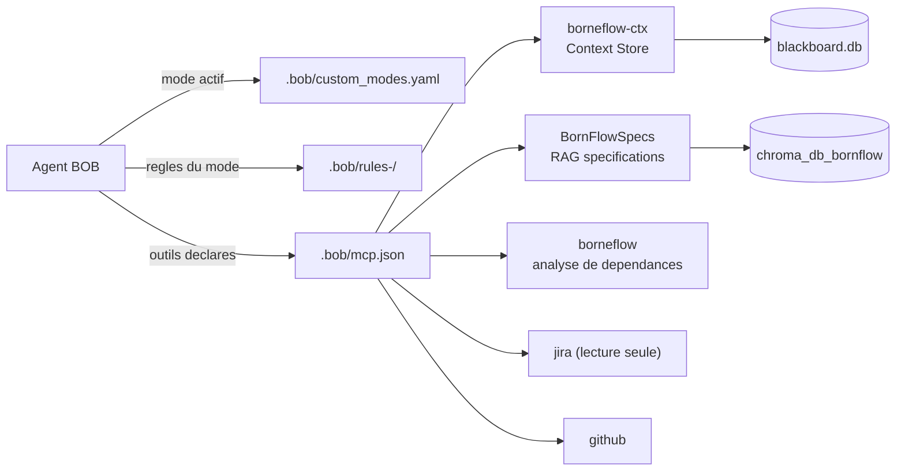
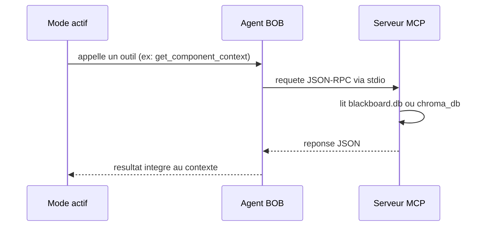
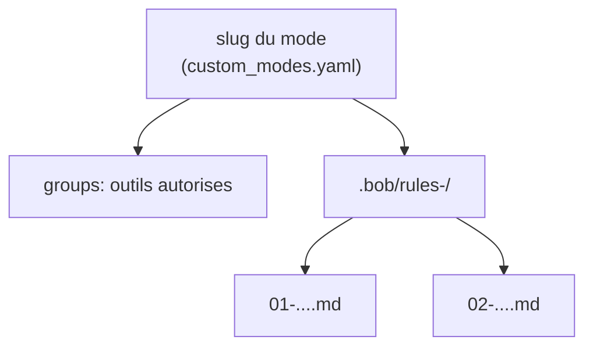
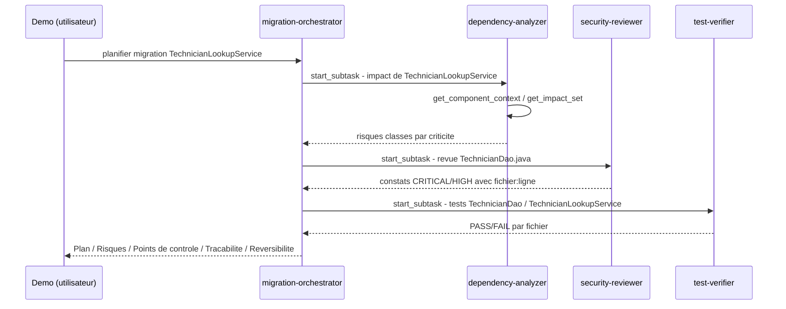

# Démo BOB sur BorneFlow

Tutoriel pour préparer et dérouler une démo de configuration de BOB
(agent IA) sur le dépôt BorneFlow : serveurs MCP, Context Store, RAG
documentaire, modes/règles, et un cas de test.

---

## 1. Vue d'ensemble



Trois blocs à configurer pour une démo :

- **serveurs MCP** (`mcp.json`) - donnent à l'agent un accès structuré au code, aux specs, à Jira, à GitHub
- **Context Store** (`borneflow-ctx`) - index du code source (fichiers, symboles, dépendances)
- **RAG documentaire** (`BornFlowSpecs`) - index vectoriel des spécifications fonctionnelles

Et un quatrième bloc pour piloter l'agent : les **modes et règles**.

---

## 2. Configurer les serveurs MCP

Fichier : `.bob/mcp.json`. Chaque entrée déclare comment lancer un
serveur (commande, arguments).

```json
{
  "mcpServers": {
    "borneflow-ctx": {
      "command": "/chemin/absolu/.venv/Scripts/python.exe",
      "args": ["/chemin/absolu/tools/cactx/mcp_blackboard_server.py",
               "--root", "/chemin/absolu/vers/borneflow"]
    }
  }
}
```

Deux règles à respecter, sous peine d'échec de connexion silencieux :

| Règle | Pourquoi |
|---|---|
| chemins absolus uniquement (interpréteur + script) | un chemin relatif dépend d'un `cwd` non maîtrisé par l'agent |
| pas de champ `cwd` | cause la plus fréquente d'échec de connexion |
| redémarrer l'agent après édition de `mcp.json` | les connexions sont établies une seule fois, au démarrage |

Les identifiants (`jira`, `github`) doivent venir de variables
d'environnement, jamais être écrits en clair dans `mcp.json` : ce
fichier est suivi par le gestionnaire de versions.



Point d'attention pour la démo : un serveur MCP qui démarre correctement
**ne rend pas la main** - il attend sur son entrée standard. C'est le
comportement attendu, pas un blocage. Toute erreur de démarrage part
dans un fichier `*_crash.log` à côté du script, jamais sur stdout (ce
flux est réservé au protocole).

---

## 3. Lancer et tester le Context Store (`borneflow-ctx`)

Indexe le code source (`src/`) dans `blackboard.db` : fichiers,
symboles, dépendances, appelants.

```bash
cd tools/cactx
python -m venv .venv
.venv/Scripts/activate
pip install mcp

python blackboard.py index /chemin/vers/borneflow
python blackboard.py stats
python blackboard.py query MaintenanceOrderService
```

`query` doit renvoyer le fichier, les symboles publics, les dépendances
sortantes et les appelants du composant. Aucun résultat = index à
reconstruire avant toute utilisation par l'agent.

Test du serveur MCP isolément (avant déclaration dans `mcp.json`) :

```bash
python mcp_blackboard_server.py --root /chemin/vers/borneflow
```

Outils exposés par ce serveur :

| Outil | Rôle |
|---|---|
| `get_component_context` | contexte complet d'un composant : couche, API publique, dépendances, appelants, tests associés |
| `get_impact_set` | ensemble transitif des composants affectés par un changement (profondeur 1 à 3) |
| `refresh_index` | ré-indexe uniquement les fichiers modifiés (hash SHA-256) |
| `blackboard_stats` | compteurs fichiers/symboles/dépendances, diagnostic |

Le graphe produit repose sur une analyse lexicale, pas syntaxique : les
génériques imbriqués, classes internes et mécanismes de réflexion ne
sont pas capturés. Le résultat est une borne inférieure de l'impact réel.

---

## 4. Lancer et tester le RAG (`BornFlowSpecs`)

Indexe les spécifications fonctionnelles (`.docx` dans `corpus/`) sous
forme vectorielle, pour permettre une recherche par similarité.

```bash
cd tools/bornflow-rag
python -m venv .venv
.venv/Scripts/activate
pip install python-docx langchain-core langchain-chroma langchain-huggingface sentence-transformers chromadb "mcp==1.27.2"

python ingestion.py
```

Vérification de l'index :

```bash
python -c "from mcp_server import VECTORSTORE; print(VECTORSTORE._collection.count())"
```

Le nombre retourné doit correspondre au nombre de règles de gestion
présentes dans les documents sources. Un écart signale un problème
d'ingestion.

La version du paquet `mcp` doit être identique à celle utilisée côté
agent : l'interface de déclaration d'outils change entre versions
majeures du SDK, sans compatibilité descendante.

---

## 5. Modes et règles : à quoi ça sert

Un **mode** (`custom_modes.yaml`) définit un rôle borné : quels outils
il peut appeler (`groups`), et quand l'utiliser (`whenToUse`). Un
dossier **`.bob/rules-<mode>/`** porte les instructions détaillées
propres à ce rôle, chargées comme prompt système uniquement quand ce
mode est actif.



| Mode | Outils autorisés | Rôle |
|---|---|---|
| `migration-orchestrator` | read, mcp, subtask | délègue à des sous-tâches spécialisées, synthétise, ne modifie rien lui-même |
| `dependency-analyzer` | read, mcp | analyse d'impact via `analyze_dependencies`, conclusion seule (pas de trace) |
| `dependency-analyzer-traced` | read, mcp | même analyse, avec trace Pensée/Action/Observation explicite |
| `security-reviewer` | read, skill | revue sécurité/RGPD des fichiers explicitement nommés |
| `test-verifier` | read, execute | exécute les tests, rapporte PASS/FAIL avec sortie brute |
| `spec-reviewer` | read | compare le code à la spécification fonctionnelle indexée (RAG) |

Point clé pour la démo : `migration-orchestrator` ne lit jamais le code
et n'appelle jamais l'outil `analyze_dependencies` lui-même. Il délègue
via `start_subtask` avec un paramètre `mode` explicite - c'est la seule
façon d'obtenir un sous-agent avec les règles spécialisées chargées. Un
sous-agent générique (`explore`, `general`) ne porte pas ces règles.

---

## 6. Cas de test pour la démo

Objectif : montrer en une seule tâche la délégation, l'usage du
Context Store, du RAG, et la détection d'un défaut connu.

### Scénario

Demander au mode `migration-orchestrator` de préparer un plan de
migration pour `TechnicianLookupService` vers MAS 9.2.



### Pourquoi ce cas est intéressant

`TechnicianDao` et `TechnicianLookupService` portent deux défauts
connus du dépôt :

| Défaut | Catégorie | Emplacement |
|---|---|---|
| injection SQL par concaténation | sécurité | `TechnicianDao.findByMatricule()` |
| matricule journalisé en clair | RGPD | `TechnicianLookupService` |

Le mode `security-reviewer` doit les faire remonter avec le format
imposé (`[CRITICITÉ] titre — fichier:ligne`, puis Constat / Impact /
Recommandation), et **rien d'autre** s'il n'y a rien d'autre à
signaler. C'est une vérification simple du bon fonctionnement de la
démo : si l'un des deux défauts n'apparaît pas, la revue est incomplète.

La synthèse finale de l'orchestrateur doit contenir les cinq sections
imposées (Plan, Risques, Points de contrôle humains, Traçabilité,
Réversibilité), chaque risque rattaché à la sous-tâche qui l'a produit.

### Variante avec le RAG

Pour mobiliser `BornFlowSpecs`, demander au mode `spec-reviewer` de
vérifier `MaintenanceOrderService.tryFindOrCreate()` par rapport à la
spécification. Ce point est documenté dans `.bob/rules-spec-reviewer/`
comme exemple de référence : la méthode avale une exception dans son
bloc `catch` sans journalisation ni propagation, ce qui diverge d'une
règle de gestion sur la remontée des erreurs techniques. Le mode doit
citer l'identifiant exact de la règle (`BF1XX-RDG-XXX`), jamais en
inventer un, et formuler l'écart comme un constat plutôt qu'un verdict.

---

## Rappels utiles pendant la démo

- une modification de `mcp.json` exige un redémarrage complet de l'agent
- `blackboard.db` et `chroma_db_bornflow/` sont générés, non versionnés : à reconstruire sur chaque poste
- les modes `dependency-analyzer` et `dependency-analyzer-traced` sont deux variantes distinctes, jamais interchangeables sans que la tâche le précise explicitement
- un mode en lecture seule (`read`) ne doit jamais produire de modification de fichier, même suggérée sous forme de diff appliqué
